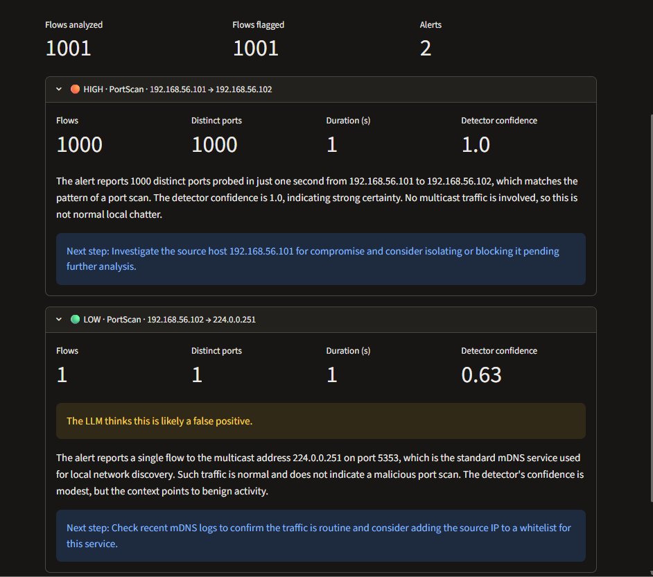
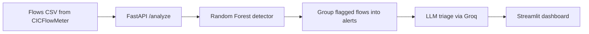
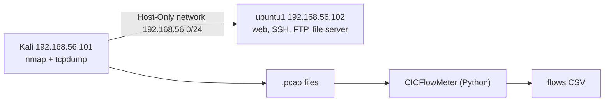

# Network Alert Triage

A machine learning detector for network attacks, plus an LLM agent that groups the detections into alerts and explains each one. Everything runs locally.

 



https://github.com/user-attachments/assets/2508eebc-5fa9-47c3-a2ca-6640203e5bad

## What it does

1. **Detect:** a Random Forest classifies each network flow (one row per connection) as normal or as an attack type.
2. **Group:** flagged flows are grouped into alerts per attacker, target and attack type, with facts an analyst would check (distinct ports, duration, multicast target, detector confidence).
3. **Triage:** an LLM (Groq, `openai/gpt-oss-120b`) returns a severity, whether it is likely a false positive, a short explanation and a next step.
4. **Show:** a Streamlit dashboard lists the alerts, most dangerous first.



## Run it

You need Docker and a free Groq API key.

```bash
git clone https://github.com/EzzineMontahe/network-alert-triage.git
cd network-alert-triage
echo "GROQ_API_KEY=your_key_here" > .env
docker compose up --build
```

Open http://localhost:8501 and upload a flows CSV (CICFlowMeter output). The `.env` file is ignored by Git, so the key is never committed. I tested this on a clean Ubuntu VM.

## The lab

To test on traffic I made myself, I built a small lab on VirtualBox: Kali attacks, an Ubuntu VM is the victim, and `tcpdump` records the traffic.



## Results

Dataset: CIC-IDS2017 (port scan, DDoS, FTP and SSH brute force), 78 features per flow.

| Experiment | Result |
|---|---|
| Random Forest, 3 attack families, random 80/20 split | 14 errors on 191,491 test flows |
| Gradient boosting, same split | 7 errors (too close to call; both scores are optimistic) |
| Isolation Forest (unsupervised, trained on normal traffic only) | Unusable: about 98% of its alerts were false at 1% attack prevalence |
| Model trained on port scans only, tested on brute force | Caught 1 of 13,832: it only recognizes attack families it was trained on |
| Dataset-only model, tested on my own lab port scan | Caught 0 of 1,000 flows |

**Why it failed on my lab traffic.** My capture tool and the dataset's tool measure packets differently (packet sizes include headers in mine, and the flag counts differ). Training on my first scan made the model recognize that scan, but it still missed a second scan made with a different nmap mode. The cause was two kinds of columns that depend on the tool that builds the packet, not on scanning behavior: the TCP window size and the packet sizes.

**The fix.** I removed those 29 of 78 columns and retrained on the dataset plus my lab flows. The model then caught **1,000 of 1,001 flows** of the second scan, which it had never seen, and kept all normal lab flows correct. The cost on the dataset's own test set was small: 75 errors instead of 14.

**The agent.** On the second scan, 1,001 flagged flows become 2 alerts. The LLM rates the real scan *high* and not a false positive, and rates a single multicast (mDNS) flow *low* and a likely false positive.

## Limits

- One lab, one attacker, one victim. The second scan is the same attack with a different setting, not a different attack.
- The normal-traffic test is small (a few dozen simple flows), so the false-alarm rate is not well measured.
- The final model was trained on my lab flows, so the dashboard demo is a demonstration, not a test. The held-out second-scan result above is the real test.
- The dataset's scores come from a random split, so near-duplicate attack flows appear in both train and test. Treat them as optimistic.
- A port scan is a pattern across many flows, so a per-flow model is a weak way to detect it. Grouping the flows into alerts partly compensates, but detection from aggregated features (for example, distinct ports per source in a time window) would be better.
- The LLM prompt contains hints (for example, about multicast traffic), which makes the easy cases easier. I have not yet tested it without hints.

## Roadmap

- [x] Clean and explore CIC-IDS2017
- [x] Compare supervised and unsupervised detection
- [x] Test on unseen attack families
- [x] Build a VirtualBox lab and test on my own traffic
- [x] Detector API, LLM triage, dashboard, Docker Compose
- [ ] More attack types in the lab (brute force, DoS)
- [ ] Detect scans from aggregated features across flows
- [ ] Evaluate the LLM triage without hints in the prompt
- [ ] Automated tests

## Dataset

CIC-IDS2017, from the Canadian Institute for Cybersecurity, University of New Brunswick. The data is not included in this repo.

Sharafaldin, I., Lashkari, A. H., and Ghorbani, A. A. (2018). *Toward Generating a New Intrusion Detection Dataset and Intrusion Traffic Characterization.* ICISSP.

## Stack

Python, pandas, scikit-learn, FastAPI, Streamlit, Groq, Docker Compose, Jupyter. Lab: VirtualBox, Kali, nmap, tcpdump, CICFlowMeter (Python).
